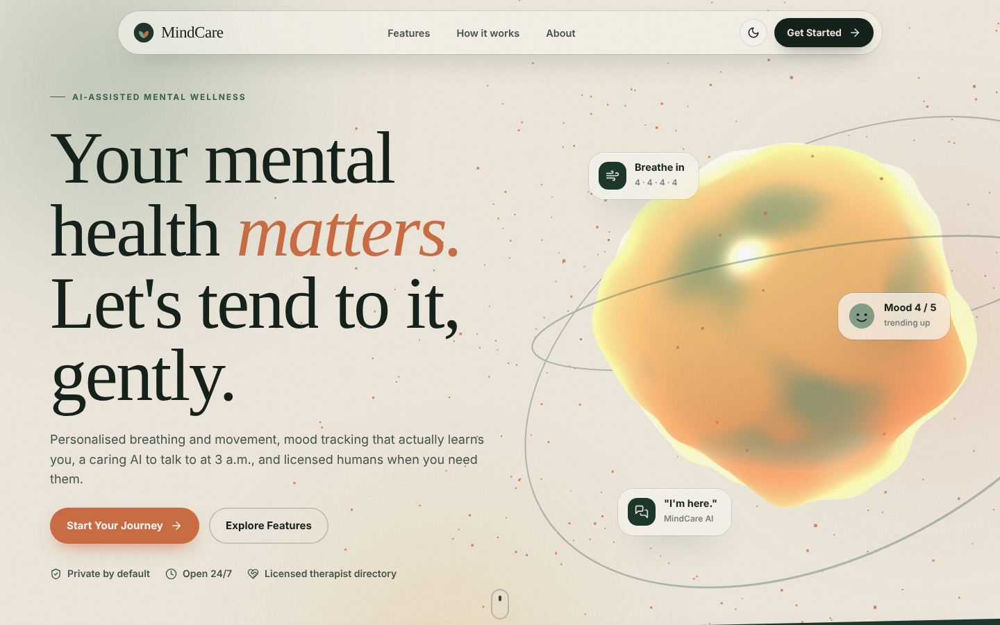
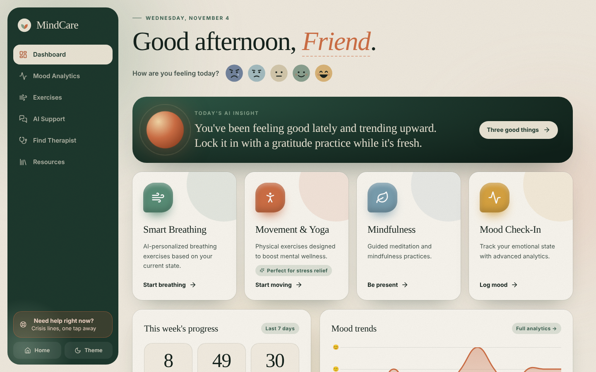
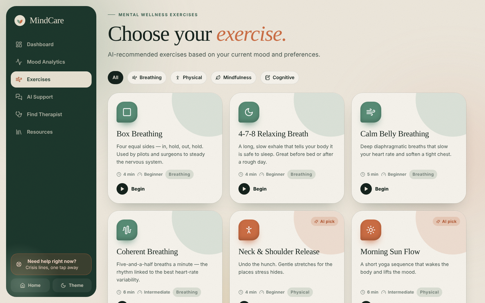
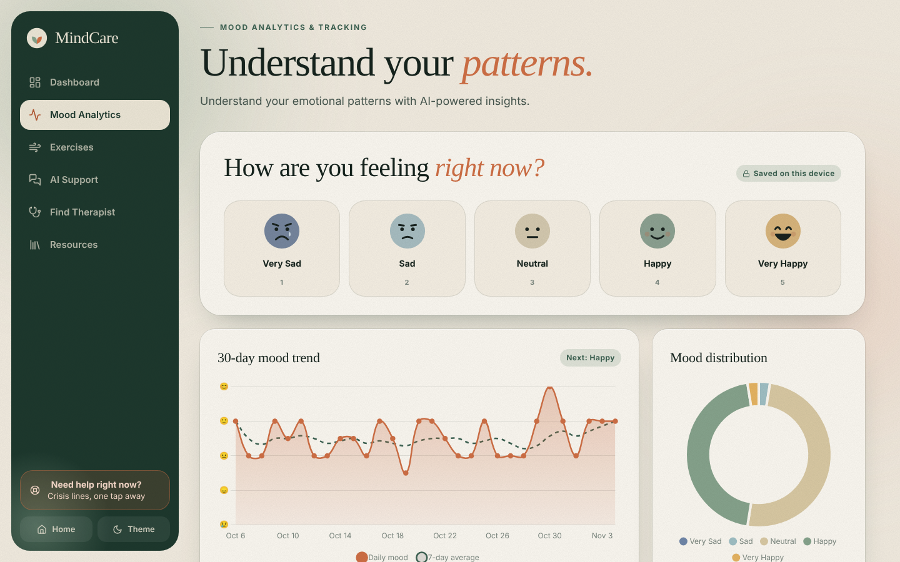
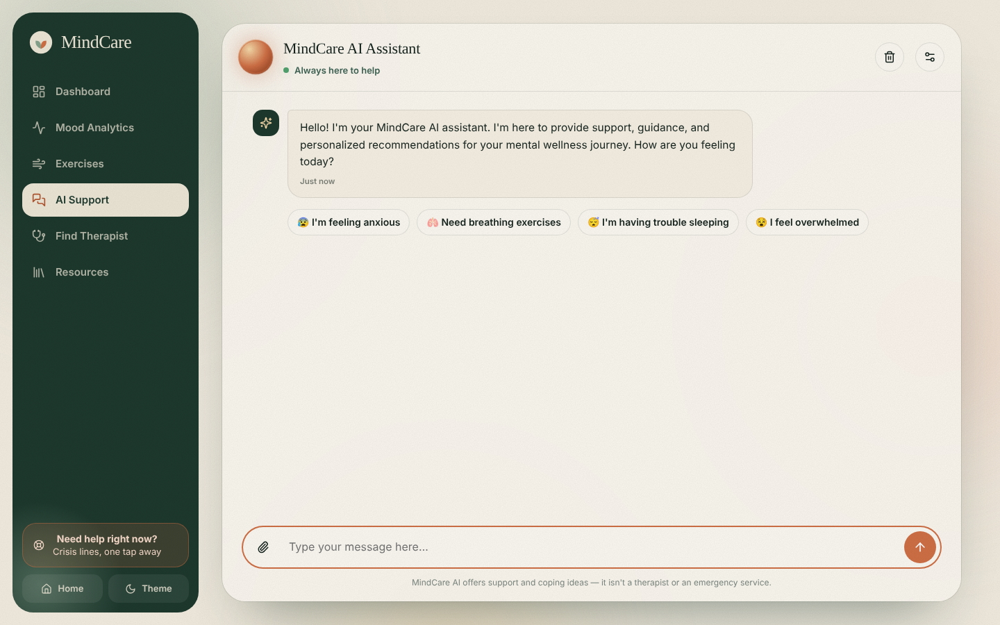
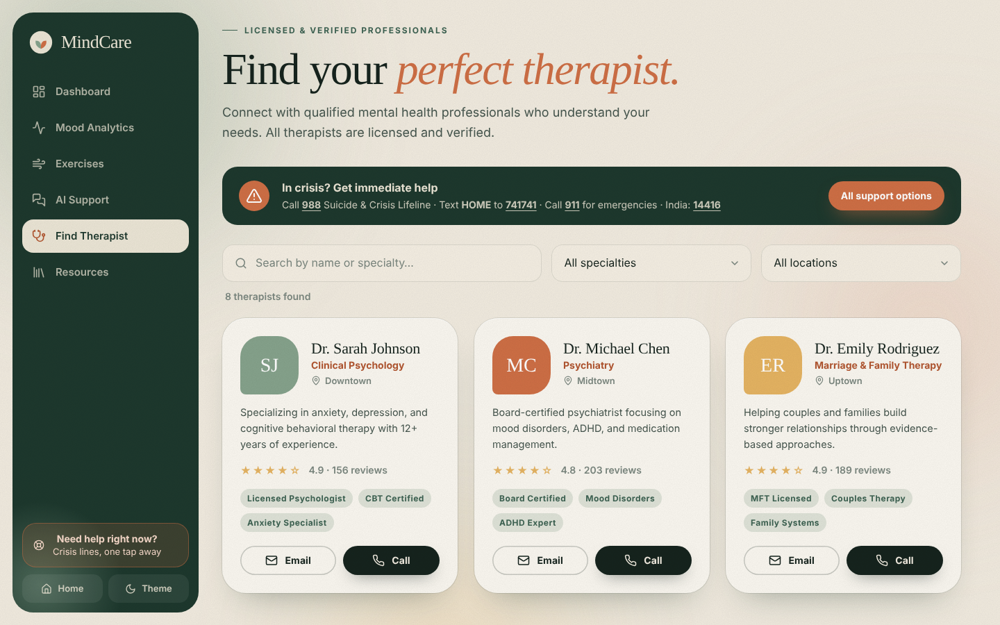
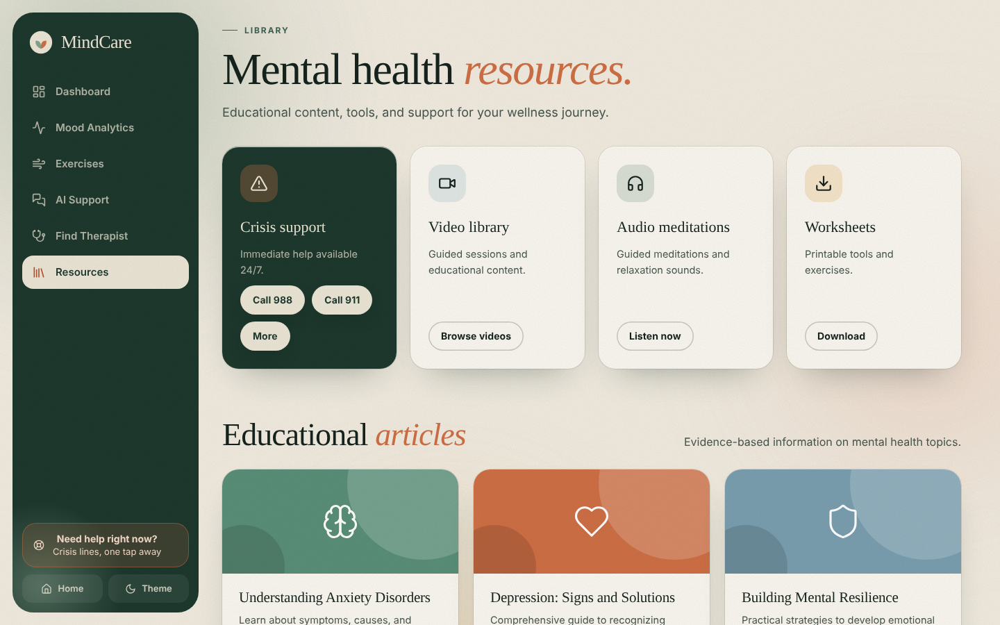
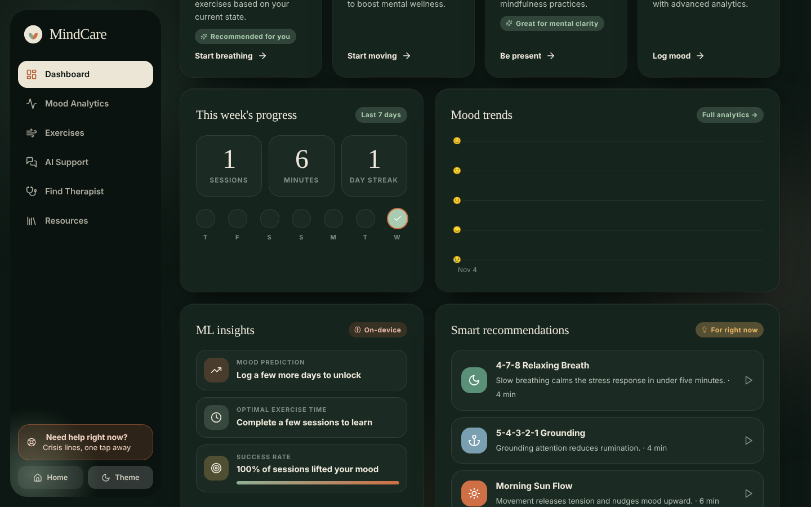

<h1 align="center">MindCare</h1>
<p align="center"><b>Your mental health matters. Let's tend to it, gently.</b><br>
A privacy-first mental wellness web app: guided exercises, mood tracking that learns your patterns, a supportive chat companion and a therapist directory.</p>

<p align="center">
  
  
  
  
</p>



## What it does
| | |
|---|---|
| **Mood tracker** | Log how you feel each day and see trends, patterns and gentle predictions |
| **Guided exercises** | Breathing, physical, mindfulness and cognitive sessions with timers and animations |
| **Chat companion** | A supportive conversation space with crisis-aware responses |
| **Therapist directory** | Browse and filter professionals |
| **Resource library** | Articles, helplines and self-help material |
| **Dashboard** | Your streaks, sessions and mood at a glance |
| **Dark mode** | Warm editorial design in light and dark, fully responsive |

## Screenshots
| Dashboard | Exercises |
|---|---|
|  |  |

| Mood tracker | Chat companion |
|---|---|
|  |  |

| Therapist directory | Resources | Dark mode |
|---|---|---|
|  |  |  |

## Privacy
Moods, sessions, journal entries, chat and settings are stored **in your own browser** (localStorage). Nothing is sent anywhere unless you connect your own backend.

## Run it
```bash
cd backend
cp .env.example .env     # add your own MongoDB URI if you use the API
npm install
npm start                # http://localhost:5000
```
The frontend is plain HTML/CSS/JS with no build step. You can also just serve the `frontend` folder (`npx serve frontend`) or open `frontend/index.html`.

## Project structure
```
frontend/   pages (home, dashboard, exercises, mood tracker, chat, therapists, resources), css/, js/
backend/    Express server (server.js, routes/chat.js)
docs/       screenshots used in this README
```

## Tech
HTML · CSS · vanilla JavaScript · three.js · Chart.js · Node.js · Express · MongoDB

> MindCare is a self-care tool, not a substitute for professional help. If you are in crisis, contact your local emergency number or a crisis helpline.
